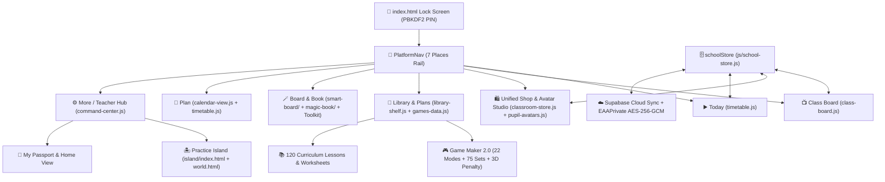

# 🗺️ English Adventure Academy — Master Site Map

> **Auto-Generated & Verified** by [build-site-map.js](file:///C:/Users/maysa/Desktop/DV/tools/build-site-map.js)  
> **Interactive Visual Hub (Local Browser):** `http://localhost:8155/site-map/index.html` ([site-map/index.html](file:///C:/Users/maysa/Desktop/DV/site-map/index.html))  
> **Refresh Map Anytime:** `node tools/build-site-map.js`

---

## ⚡ 1. Platform At-a-Glance

| Metric | Count | Primary Source |
| :--- | :---: | :--- |
| **Top-Level Navigation Places** | **7** | [platform-nav.js](file:///C:/Users/maysa/Desktop/DV/js/platform-nav.js#L11-L28) |
| **Dynamic `switchView()` Views** | **42** | [school-app.js](file:///C:/Users/maysa/Desktop/DV/js/school-app.js#L10109-L10168) |
| **Reusable Modals in `index.html`** | **69** | [index.html](file:///C:/Users/maysa/Desktop/DV/index.html#L480-L4390) |
| **Platform JS Modules (`js/*.js`)** | **90** (69 in `index.html`) | [02-core-js-and-monoliths.md](file:///C:/Users/maysa/Desktop/DV/docs/map/02-core-js-and-monoliths.md) |
| **Platform Stylesheets (`css/*.css`)** | **13** (9 in `index.html`) | [01-platform-screens-and-dom.md](file:///C:/Users/maysa/Desktop/DV/docs/map/01-platform-screens-and-dom.md) |
| **Game Maker 2.0 Arcade Modes** | **22 modes** + **75 question sets** | [04-game-maker.md](file:///C:/Users/maysa/Desktop/DV/docs/map/04-game-maker.md) |
| **Registered `GAMES_DATA` Modules** | **122** | [games-data.js](file:///C:/Users/maysa/Desktop/DV/js/games-data.js) |
| **Printable Lesson Plans (Word/PDF)** | **56 lessons** | [05-lessons-island-and-curriculum.md](file:///C:/Users/maysa/Desktop/DV/docs/map/05-lessons-island-and-curriculum.md) |
| **Supabase Cloud Tables / Storage Keys** | **16 tables** / **25 keys** | [06-cloud-storage-and-privacy.md](file:///C:/Users/maysa/Desktop/DV/docs/map/06-cloud-storage-and-privacy.md) |

---

## 📂 2. Modular Deep-Dive Map Index (`docs/map/`)

1. **[01-platform-screens-and-dom.md](file:///C:/Users/maysa/Desktop/DV/docs/map/01-platform-screens-and-dom.md)** — Entry HTML pages, 7-place sidebar/rail, all 42 `switchView` routes, all 69 modals, toolkit tabs, and exact CSS/JS load order.
2. **[02-core-js-and-monoliths.md](file:///C:/Users/maysa/Desktop/DV/docs/map/02-core-js-and-monoliths.md)** — All 90 `js/*.js` & 13 `css/*.css` files, plus full line-range chapters inside `school-app.js` (17221 lines) and `school-store.js` (17601 lines).
3. **[03-avatars-monsters-and-store.md](file:///C:/Users/maysa/Desktop/DV/docs/map/03-avatars-monsters-and-store.md)** — `PupilAvatars` (2D + 3D extruded rig), Unified `ClassroomStore`, `MonsterRenderer` 8-layer stage, Mystery Boxes, and `assets/avatars/` layout.
4. **[04-game-maker.md](file:///C:/Users/maysa/Desktop/DV/docs/map/04-game-maker.md)** — All 22 Game Maker arcade modes (including 3D Penalty Shootout), 75 question sets, engine & audio architecture.
5. **[05-lessons-island-and-curriculum.md](file:///C:/Users/maysa/Desktop/DV/docs/map/05-lessons-island-and-curriculum.md)** — All Grade 3 & Grade 4 lessons, `GAMES_DATA`, `Timetable` catalog, `lesson-plans/`, `island/`, `passport/`, `home-view/`, and `404.html` routes.
6. **[06-cloud-storage-and-privacy.md](file:///C:/Users/maysa/Desktop/DV/docs/map/06-cloud-storage-and-privacy.md)** — Supabase tables & SQL schemas, `localStorage` keys, `EAAPrivate` encrypted pupil data, `eaa:*` events, and full **120+ Root Folder Git & Privacy Audit**.

---

## 🧭 3. System Architecture Graph

---

## 🎯 4. "Where Do I Edit X?" — Instant Task Cheat-Sheet

| Task / Feature | File | Lines | Key Symbol / Entry |
| :--- | :--- | :---: | :--- |
| Change sidebar / 7-place navigation or Class Mode rail | [js/platform-nav.js](file:///C:/Users/maysa/Desktop/DV/js/platform-nav.js) | `L11–L92` | `PLACES, MORE, PlatformNav.go()` |
| Add or edit a main platform view (`switchView`) | [js/school-app.js](file:///C:/Users/maysa/Desktop/DV/js/school-app.js) | `L1046 & L10109–L10168` | `window.switchView, renderCurrentView()` |
| Edit Today view schedule or add lesson to Timetable catalog | [js/timetable.js](file:///C:/Users/maysa/Desktop/DV/js/timetable.js) | `L7–L260` | `CATALOG, Timetable.todayHtml()` |
| Register a new lesson or game in the Library | [js/games-data.js](file:///C:/Users/maysa/Desktop/DV/js/games-data.js) | `L1–end` | `window.GAMES_DATA` |
| Add a friendly URL / deep-link redirect on GitHub Pages | [404.html](file:///C:/Users/maysa/Desktop/DV/404.html) | `L151–L347` | `pathname routing chain` |
| Edit Live Class Board, pupil tiles, Groups, Picker or Karaoke | [js/class-board.js](file:///C:/Users/maysa/Desktop/DV/js/class-board.js) | `L1–end` | `window.ClassBoard, renderClassBoardView` |
| Edit Pupil 3D Avatars, body proportions, outfits or 3D Pitch Rig | [js/pupil-avatars.js](file:///C:/Users/maysa/Desktop/DV/js/pupil-avatars.js) | `L1–end` | `window.PupilAvatars, composePitchRigParts()` |
| Edit Unified Pupil Shop, Avatar Customizer & try-on drawers | [js/classroom-store.js](file:///C:/Users/maysa/Desktop/DV/js/classroom-store.js) | `L1–end` | `window.ClassroomStore, renderClassroomStoreView` |
| Edit Monster 8-layer SVG renderer or Dragon companion | [js/monster-renderer.js](file:///C:/Users/maysa/Desktop/DV/js/monster-renderer.js) | `L1–end` | `MonsterRenderer.renderMonsterLiveStage()` |
| Edit Mystery Box rewards, probabilities & opening animation | [js/mystery-box-v2.js](file:///C:/Users/maysa/Desktop/DV/js/mystery-box-v2.js) | `L1–end` | `window.MysteryBoxV2` |
| Edit Student Roster, XP Ledger, Coins, Classes or Level Unlocks | [js/school-store.js](file:///C:/Users/maysa/Desktop/DV/js/school-store.js) | `L1–end` | `window.schoolStore (SchoolPlatformStore)` |
| Edit Teacher Hub (Command Center: XP, logs, bulk actions) | [js/command-center.js](file:///C:/Users/maysa/Desktop/DV/js/command-center.js) | `L1–end` | `window.renderCommandCenterView` |
| Add or tweak a Game Maker arcade mode (22 modes) | [game-maker/js/mode-*.js](file:///C:/Users/maysa/Desktop/DV/game-maker/js/mode-*.js) | `See 04-game-maker.md` | `GM.modes.<id>` |
| Edit 3D Penalty Shootout stadium, physics or Pixar 3D players | [game-maker/js/mode-penalty.js](file:///C:/Users/maysa/Desktop/DV/game-maker/js/mode-penalty.js) | `L1–L960` | `GM.modes.penalty, makeCharacterRig()` |
| Add a new vocabulary / speaking question bank to Game Maker | [game-maker/js/sets-unit5.js](file:///C:/Users/maysa/Desktop/DV/game-maker/js/sets-unit5.js) | `L1–end` | `GM.sets.push(...)` |
| Edit Practice Island home world, chapters or harbour shop | [island/js/app.js](file:///C:/Users/maysa/Desktop/DV/island/js/app.js) | `L1–end` | `island/index.html & island/world.html` |
| Edit Student Passport booklets & class gallery | [passport/index.html](file:///C:/Users/maysa/Desktop/DV/passport/index.html) | `L1–end` | `passport/js/*` |
| Edit Supabase PostgreSQL sync, tables or realtime channels | [js/supabase-client.js](file:///C:/Users/maysa/Desktop/DV/js/supabase-client.js) | `L1–end` | `window.supabaseClient + js/school-cloud-sync.js` |
| Check encrypted private pupil bundle (survey, parent notes, birthdays) | [js/private-data.js](file:///C:/Users/maysa/Desktop/DV/js/private-data.js) | `L1–L60` | `EAAPrivate.load(), EAAPrivate.get()` |
| Edit Classroom Soundboard (1–7 hotkeys, Web Audio synthesis) | [js/classroom-sounds.js](file:///C:/Users/maysa/Desktop/DV/js/classroom-sounds.js) | `L1–end` | `window.classSoundboard` |
| Re-generate this entire Site Map after adding files or lessons | [tools/build-site-map.js](file:///C:/Users/maysa/Desktop/DV/tools/build-site-map.js) | `CLI` | `node tools/build-site-map.js` |

---

## 🏛️ 5. Giant Monolith Quick-Jump (`school-app.js` & `school-store.js`)

### A. [school-app.js](file:///C:/Users/maysa/Desktop/DV/js/school-app.js) (17221 lines · 1047.9 KB)
| Line Range | Chapter / Section |
| :---: | :--- |
| [L117–L391](file:///C:/Users/maysa/Desktop/DV/js/school-app.js#L117-L391) | 1. INITIALIZATION & GLOBAL EVENT LISTENERS |
| [L392–L936](file:///C:/Users/maysa/Desktop/DV/js/school-app.js#L392-L936) | SUPABASE CLOUD DATABASE CONFIGURATION & MANAGEMENT MODAL CONTROLLER |
| [L937–L1130](file:///C:/Users/maysa/Desktop/DV/js/school-app.js#L937-L1130) | GLOBAL GAME LAUNCHER ROUTING |
| [L1131–L1211](file:///C:/Users/maysa/Desktop/DV/js/school-app.js#L1131-L1211) | 4 ELEMENTAL SPECIES ARCHETYPES (LOCAL 3D RASTER MASCOTS) |
| [L1212–L1555](file:///C:/Users/maysa/Desktop/DV/js/school-app.js#L1212-L1555) | CANONICAL STUDENT MONSTER AVATAR & STAGE RENDERER (3D RASTER MASCOTS) |
| [L1556–L1691](file:///C:/Users/maysa/Desktop/DV/js/school-app.js#L1556-L1691) | 2. MODAL & CONFIRMATION CONTROLLERS |
| [L1692–L2709](file:///C:/Users/maysa/Desktop/DV/js/school-app.js#L1692-L2709) | 3. ENTITY CRUD HANDLERS (STUDENTS, CLASSES, GAMES, CURRICULUM, ETC.) |
| [L2710–L3396](file:///C:/Users/maysa/Desktop/DV/js/school-app.js#L2710-L3396) | 4. STUDENT PROFILE MANAGEMENT CENTER (8 SUB-TABS) |
| [L3397–L3788](file:///C:/Users/maysa/Desktop/DV/js/school-app.js#L3397-L3788) | 5. VIEW CONTROLLERS (STUDENTS, CLASSES, CURRICULUM, LIBRARY, ETC.) |
| [L3789–L4686](file:///C:/Users/maysa/Desktop/DV/js/school-app.js#L3789-L4686) | CLASSROOM HUB (Heart of the Class: Visual Avatars, Groups, Points, Toolkit) |
| [L4687–L5174](file:///C:/Users/maysa/Desktop/DV/js/school-app.js#L4687-L5174) | CURRICULUM MANAGEMENT (Reordering, Units, Lessons, Objectives) |
| [L5175–L6389](file:///C:/Users/maysa/Desktop/DV/js/school-app.js#L5175-L6389) | let libraryActiveCatalogTab = 'games'; // 'games' | 'worksheets' |
| [L6390–L6579](file:///C:/Users/maysa/Desktop/DV/js/school-app.js#L6390-L6579) | DETAILED PEDAGOGICAL RESOURCE PREVIEW MODAL |
| [L6580–L6748](file:///C:/Users/maysa/Desktop/DV/js/school-app.js#L6580-L6748) | PRINTABLE WORKSHEETS HUB & REAL LIBRARY |
| [L6749–L6931](file:///C:/Users/maysa/Desktop/DV/js/school-app.js#L6749-L6931) | /* ---- Weekly Assignments & Homework: one place, grouped by week, with every pupil's status ---- */ |
| [L6932–L7163](file:///C:/Users/maysa/Desktop/DV/js/school-app.js#L6932-L7163) | HOMEWORK & QUESTS VIEW (Full CRUD, Student Quest & Centralized XP System) |
| [L7164–L7414](file:///C:/Users/maysa/Desktop/DV/js/school-app.js#L7164-L7414) | 2-COLUMN CREATE / EDIT HOMEWORK MODAL & LIVE PREVIEW |
| [L7415–L7638](file:///C:/Users/maysa/Desktop/DV/js/school-app.js#L7415-L7638) | 3. STUDENT QUEST VIEW & SUBMISSION CONTROLLER |
| [L7639–L7790](file:///C:/Users/maysa/Desktop/DV/js/school-app.js#L7639-L7790) | 4. QUEST COMPLETED CELEBRATION MODAL |
| [L7791–L8011](file:///C:/Users/maysa/Desktop/DV/js/school-app.js#L7791-L8011) | ALICE IN WONDERLAND XP QUEST SINGLE-STUDENT GRADER CONTROLLER |
| [L8012–L8228](file:///C:/Users/maysa/Desktop/DV/js/school-app.js#L8012-L8228) | QUIZZES & QUESTION BUILDER VIEW (Complete CRUD) |
| [L8229–L8335](file:///C:/Users/maysa/Desktop/DV/js/school-app.js#L8229-L8335) | ASSESSMENTS & RUBRICS VIEW (Complete CRUD) |
| [L8336–L8405](file:///C:/Users/maysa/Desktop/DV/js/school-app.js#L8336-L8405) | DYNAMIC REPORTS GENERATOR VIEW (Complete CRUD) |
| [L8406–L9953](file:///C:/Users/maysa/Desktop/DV/js/school-app.js#L8406-L9953) | GAMIFICATION SETTINGS VIEW (Badges, Levels, Items & XP Skills CRUD) |
| [L9954–L10114](file:///C:/Users/maysa/Desktop/DV/js/school-app.js#L9954-L10114) | SIDEBAR NAVIGATION (With Admin & Settings) |
| [L10115–L10926](file:///C:/Users/maysa/Desktop/DV/js/school-app.js#L10115-L10926) | function renderCurrentView() { |
| [L10927–L10982](file:///C:/Users/maysa/Desktop/DV/js/school-app.js#L10927-L10982) | CURRICULUM REORDERING & CRUD HANDLERS |
| [L10983–L11114](file:///C:/Users/maysa/Desktop/DV/js/school-app.js#L10983-L11114) | WORKSHEET CRUD HANDLERS |
| [L11115–L11272](file:///C:/Users/maysa/Desktop/DV/js/school-app.js#L11115-L11272) | QUIZ QUESTIONS MANAGER HANDLERS |
| [L11273–L11366](file:///C:/Users/maysa/Desktop/DV/js/school-app.js#L11273-L11366) | RUBRICS & CRITERIA HANDLERS |
| [L11367–L11496](file:///C:/Users/maysa/Desktop/DV/js/school-app.js#L11367-L11496) | GAMIFICATION & BADGES HANDLERS |
| [L11497–L11634](file:///C:/Users/maysa/Desktop/DV/js/school-app.js#L11497-L11634) | DYNAMIC REPORT GENERATOR HANDLERS |
| [L11635–L11638](file:///C:/Users/maysa/Desktop/DV/js/school-app.js#L11635-L11638) | SCHOOL SETTINGS MODAL HANDLERS |
| [L11639–L11751](file:///C:/Users/maysa/Desktop/DV/js/school-app.js#L11639-L11751) | DEDICATED ARCHIVED & RESTORE FULL PAGE VIEW |
| [L11752–L11954](file:///C:/Users/maysa/Desktop/DV/js/school-app.js#L11752-L11954) | DEDICATED SCHOOL SETTINGS FULL PAGE VIEW |
| [L11955–L11978](file:///C:/Users/maysa/Desktop/DV/js/school-app.js#L11955-L11978) | GLOBAL ACTION ALIASES FOR COMPLETE ACCESSIBILITY |
| [L11979–L12194](file:///C:/Users/maysa/Desktop/DV/js/school-app.js#L11979-L12194) | MISSING & UPGRADED CRUD HANDLERS (Assignments, Homework, Quizzes, Badges) |
| [L12195–L12276](file:///C:/Users/maysa/Desktop/DV/js/school-app.js#L12195-L12276) | CALENDAR EVENT HANDLERS |
| [L12277–L12355](file:///C:/Users/maysa/Desktop/DV/js/school-app.js#L12277-L12355) | PORTFOLIO ARTIFACT HANDLERS |
| [L12356–L12413](file:///C:/Users/maysa/Desktop/DV/js/school-app.js#L12356-L12413) | UNIVERSAL ARCHIVED & RESTORE HANDLERS |
| [L12414–L12443](file:///C:/Users/maysa/Desktop/DV/js/school-app.js#L12414-L12443) | MOVE STUDENT HANDLERS |
| [L12444–L12456](file:///C:/Users/maysa/Desktop/DV/js/school-app.js#L12444-L12456) | REAL AVATAR CUSTOMIZER HANDLER |
| [L12457–L12480](file:///C:/Users/maysa/Desktop/DV/js/school-app.js#L12457-L12480) | MESSAGE THREAD HANDLERS |
| [L12481–L12537](file:///C:/Users/maysa/Desktop/DV/js/school-app.js#L12481-L12537) | MOBILE NAVIGATION DRAWER TOGGLE |
| [L12538–L12924](file:///C:/Users/maysa/Desktop/DV/js/school-app.js#L12538-L12924) | CLASSROOM STUDENT MANAGEMENT & ADVANCED TEACHER TOOLKIT ENGINE |
| [L12925–L15671](file:///C:/Users/maysa/Desktop/DV/js/school-app.js#L12925-L15671) | DEDICATED "EDIT STUDENT XP" MODAL CONTROLLER (INTERACTIVE 3D ARTIFACT) |
| [L15672–L15856](file:///C:/Users/maysa/Desktop/DV/js/school-app.js#L15672-L15856) | ORIGINAL TEXTBOOK VIEWER CONTROLLER (GLOBAL READINGS 2) |
| [L15857–L16505](file:///C:/Users/maysa/Desktop/DV/js/school-app.js#L15857-L16505) | MONSTER EVOLUTION & COMPANION SYSTEM CONTROLLERS |
| [L16506–L16557](file:///C:/Users/maysa/Desktop/DV/js/school-app.js#L16506-L16557) | FULLSCREEN MONSTER SHOWCASE CONTROLLER |
| [L16558–L16652](file:///C:/Users/maysa/Desktop/DV/js/school-app.js#L16558-L16652) | SCOPE & SEQUENCE MODAL CONTROLLER |
| [L16653–L16813](file:///C:/Users/maysa/Desktop/DV/js/school-app.js#L16653-L16813) | LESSON ATTACHMENT MODALS (Games, Worksheets, Assignments) |
| [L16814–L17221](file:///C:/Users/maysa/Desktop/DV/js/school-app.js#L16814-L17221) | CURRICULUM AI TEACHER ASSISTANT |

### B. [school-store.js](file:///C:/Users/maysa/Desktop/DV/js/school-store.js) (17601 lines · 762.3 KB)
| Line Range | Chapter / Section |
| :---: | :--- |
| [L958–L961](file:///C:/Users/maysa/Desktop/DV/js/school-store.js#L958-L961) | GLOBAL READINGS 2 — LEVEL 2 STUDENT'S BOOK (MACMILLAN EDUCATION) |
| [L962–L1571](file:///C:/Users/maysa/Desktop/DV/js/school-store.js#L962-L1571) | const GLOBAL_READINGS_2_PAGES = [ |
| [L1572–L1575](file:///C:/Users/maysa/Desktop/DV/js/school-store.js#L1572-L1575) | GLOBAL READINGS 3 — LEVEL 3 STUDENT'S BOOK (MACMILLAN EDUCATION) |
| [L1576–L2153](file:///C:/Users/maysa/Desktop/DV/js/school-store.js#L1576-L2153) | const GLOBAL_READINGS_3_PAGES = [ |
| [L2154–L2239](file:///C:/Users/maysa/Desktop/DV/js/school-store.js#L2154-L2239) | MONSTER EVOLUTION SYSTEM — STANDARDIZED EVOLUTION & THRESHOLDS (7 STAGES) |
| [L2240–L2245](file:///C:/Users/maysa/Desktop/DV/js/school-store.js#L2240-L2245) | 4 DISTINCT SPECIES ARCHETYPES (SINGLE SOURCE OF TRUTH) |
| [L2246–L2491](file:///C:/Users/maysa/Desktop/DV/js/school-store.js#L2246-L2491) | const ELEMENTAL_AVATARS = { |
| [L2492–L2495](file:///C:/Users/maysa/Desktop/DV/js/school-store.js#L2492-L2495) | TERM 2 RESET CANCELLED — ARCHIVED XP RESTORATION (IDEMPOTENT, SAFE TO RE-RUN) |
| [L2496–L3072](file:///C:/Users/maysa/Desktop/DV/js/school-store.js#L2496-L3072) | const LEGACY_MIGRATION_KEYS = [ |
| [L3073–L10421](file:///C:/Users/maysa/Desktop/DV/js/school-store.js#L3073-L10421) | 📘 Alice in Wonderland: Discrete Homework XP Tasks |
| [L10422–L11391](file:///C:/Users/maysa/Desktop/DV/js/school-store.js#L10422-L11391) | CORE STORE ENGINE CLASS |
| [L11392–L11550](file:///C:/Users/maysa/Desktop/DV/js/school-store.js#L11392-L11550) | 2. STUDENTS & ENROLLMENT (18 METHODS) |
| [L11551–L12312](file:///C:/Users/maysa/Desktop/DV/js/school-store.js#L11551-L12312) | TRANSACTION-BASED XP ARCHITECTURE & AUDIT LEDGER |
| [L12313–L12559](file:///C:/Users/maysa/Desktop/DV/js/school-store.js#L12313-L12559) | 2. CLASS CRUD & ATTENDANCE CALCULATIONS |
| [L12560–L12814](file:///C:/Users/maysa/Desktop/DV/js/school-store.js#L12560-L12814) | 3. CURRICULUM HIERARCHY CRUD |
| [L12815–L13132](file:///C:/Users/maysa/Desktop/DV/js/school-store.js#L12815-L13132) | 4. RESOURCE / GAME CRUD |
| [L13133–L13354](file:///C:/Users/maysa/Desktop/DV/js/school-store.js#L13133-L13354) | 5. ASSIGNMENTS & HOMEWORK CRUD |
| [L13355–L14185](file:///C:/Users/maysa/Desktop/DV/js/school-store.js#L13355-L14185) | 6. QUIZZES & ASSESSMENTS CRUD |
| [L14186–L14268](file:///C:/Users/maysa/Desktop/DV/js/school-store.js#L14186-L14268) | getClassStory(classId = null, includeArchived = false) { |
| [L14269–L15144](file:///C:/Users/maysa/Desktop/DV/js/school-store.js#L14269-L15144) | 8. UNIVERSAL ACTIVITY COMPLETION HOOK |
| [L15145–L15201](file:///C:/Users/maysa/Desktop/DV/js/school-store.js#L15145-L15201) | CALENDAR EVENTS CRUD |
| [L15202–L15379](file:///C:/Users/maysa/Desktop/DV/js/school-store.js#L15202-L15379) | UNIVERSAL RESTORE & ARCHIVE AUDIT ENGINE |
| [L15380–L15417](file:///C:/Users/maysa/Desktop/DV/js/school-store.js#L15380-L15417) | STUDENT MOVEMENTS & ENROLLMENT |
| [L15418–L15533](file:///C:/Users/maysa/Desktop/DV/js/school-store.js#L15418-L15533) | ENHANCED ENTITY EDITS (Assessments, Portfolios, Books, Objectives, Groups) |
| [L15534–L15616](file:///C:/Users/maysa/Desktop/DV/js/school-store.js#L15534-L15616) | XP SKILLS MANAGEMENT (ClassDojo-style Positive & Needs Work Skills) |
| [L15617–L15711](file:///C:/Users/maysa/Desktop/DV/js/school-store.js#L15617-L15711) | CLASSROOM REWARDS & REDEMPTION SYSTEM |
| [L15712–L15788](file:///C:/Users/maysa/Desktop/DV/js/school-store.js#L15712-L15788) | BIG IDEAS CLASSROOM BOARD (ClassDojo-style Brainstorming & Projects) |
| [L15789–L15817](file:///C:/Users/maysa/Desktop/DV/js/school-store.js#L15789-L15817) | ORIGINAL ADVENTURE AVATAR SYSTEM (6 Categories) |
| [L15818–L15918](file:///C:/Users/maysa/Desktop/DV/js/school-store.js#L15818-L15918) | GROUP TOTAL XP & MONTHLY TEAM RACE XP |
| [L15919–L15975](file:///C:/Users/maysa/Desktop/DV/js/school-store.js#L15919-L15975) | STUDENT AWARDS (SEPARATE FROM BADGE DEFINITIONS) |
| [L15976–L17253](file:///C:/Users/maysa/Desktop/DV/js/school-store.js#L15976-L17253) | PROGRESS CHECK ENGINE CRUD & PERSISTENCE METHODS |
| [L17254–L17601](file:///C:/Users/maysa/Desktop/DV/js/school-store.js#L17254-L17601) | MYSTERY BOXES, STUDENT INVENTORY & TRADING ENGINE |

---

## 🛡️ 6. Non-Negotiable Safety & Operating Rules

1. **Mirror Every Edit (`AGENTS.md` §2.1):** Copy every modified/created file to `monster day/story/mouse/pokemon/firefighter/NH/<same-path>` and run `node --check` on both copies.
2. **Never Use `git add -A` or `git add .` (`AGENTS.md` §2.3):** **48 published folders** are intentionally absent on local disk (see [06-cloud-storage-and-privacy.md](file:///C:/Users/maysa/Desktop/DV/docs/map/06-cloud-storage-and-privacy.md)). Stage ONLY the exact files you changed, and push to `main` + `gh-pages` ONLY when the teacher explicitly says **"push"**.
3. **Pupil Privacy (`AGENTS.md` §8):** Never commit real pupil names, photos, survey answers, or non-`student-*` files in `assets/avatars/` (0 local untracked file(s) currently flagged & redacted by privacy guard).
4. **Safe Local Testing:** Always test `index.html` via `_tmp/safe-cdp.js` (blocks live Supabase writes). `site-map/index.html` is 100% standalone & cloud-free.
