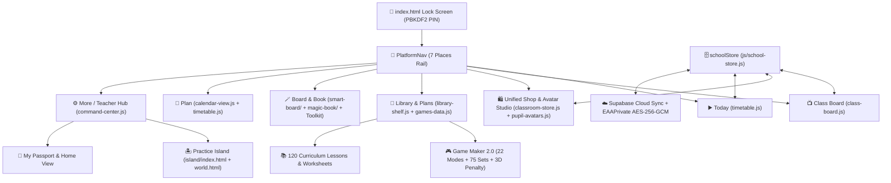

# 🗺️ English Adventure Academy — Master Site Map

> **Auto-Generated & Verified** by [build-site-map.js](file:///C:/Users/maysa/Desktop/DV/tools/build-site-map.js)  
> **Interactive Visual Hub (Local Browser):** `http://localhost:8155/site-map/index.html` ([site-map/index.html](file:///C:/Users/maysa/Desktop/DV/site-map/index.html))  
> **Refresh Map Anytime:** `node tools/build-site-map.js`

---

## ⚡ 1. Platform At-a-Glance

| Metric | Count | Primary Source |
| :--- | :---: | :--- |
| **Top-Level Navigation Places** | **7** | [platform-nav.js](file:///C:/Users/maysa/Desktop/DV/js/platform-nav.js#L11-L28) |
| **Dynamic `switchView()` Views** | **42** | [school-app.js](file:///C:/Users/maysa/Desktop/DV/js/school-app.js#L10109-L10168) |
| **Reusable Modals in `index.html`** | **69** | [index.html](file:///C:/Users/maysa/Desktop/DV/index.html#L480-L4390) |
| **Platform JS Modules (`js/*.js`)** | **90** (69 in `index.html`) | [02-core-js-and-monoliths.md](file:///C:/Users/maysa/Desktop/DV/docs/map/02-core-js-and-monoliths.md) |
| **Platform Stylesheets (`css/*.css`)** | **12** (8 in `index.html`) | [01-platform-screens-and-dom.md](file:///C:/Users/maysa/Desktop/DV/docs/map/01-platform-screens-and-dom.md) |
| **Game Maker 2.0 Arcade Modes** | **22 modes** + **75 question sets** | [04-game-maker.md](file:///C:/Users/maysa/Desktop/DV/docs/map/04-game-maker.md) |
| **Registered `GAMES_DATA` Modules** | **122** | [games-data.js](file:///C:/Users/maysa/Desktop/DV/js/games-data.js) |
| **Printable Lesson Plans (Word/PDF)** | **56 lessons** | [05-lessons-island-and-curriculum.md](file:///C:/Users/maysa/Desktop/DV/docs/map/05-lessons-island-and-curriculum.md) |
| **Supabase Cloud Tables / Storage Keys** | **16 tables** / **25 keys** | [06-cloud-storage-and-privacy.md](file:///C:/Users/maysa/Desktop/DV/docs/map/06-cloud-storage-and-privacy.md) |

---

## 📂 2. Modular Deep-Dive Map Index (`docs/map/`)

1. **[01-platform-screens-and-dom.md](file:///C:/Users/maysa/Desktop/DV/docs/map/01-platform-screens-and-dom.md)** — Entry HTML pages, 7-place sidebar/rail, all 42 `switchView` routes, all 69 modals, toolkit tabs, and exact CSS/JS load order.
2. **[02-core-js-and-monoliths.md](file:///C:/Users/maysa/Desktop/DV/docs/map/02-core-js-and-monoliths.md)** — All 90 `js/*.js` & 12 `css/*.css` files, plus full line-range chapters inside `school-app.js` (17214 lines) and `school-store.js` (17598 lines).
3. **[03-avatars-monsters-and-store.md](file:///C:/Users/maysa/Desktop/DV/docs/map/03-avatars-monsters-and-store.md)** — `PupilAvatars` (2D + 3D extruded rig), Unified `ClassroomStore`, `MonsterRenderer` 8-layer stage, Mystery Boxes, and `assets/avatars/` layout.
4. **[04-game-maker.md](file:///C:/Users/maysa/Desktop/DV/docs/map/04-game-maker.md)** — All 22 Game Maker arcade modes (including 3D Penalty Shootout), 75 question sets, engine & audio architecture.
5. **[05-lessons-island-and-curriculum.md](file:///C:/Users/maysa/Desktop/DV/docs/map/05-lessons-island-and-curriculum.md)** — All Grade 3 & Grade 4 lessons, `GAMES_DATA`, `Timetable` catalog, `lesson-plans/`, `island/`, `passport/`, `home-view/`, and `404.html` routes.
6. **[06-cloud-storage-and-privacy.md](file:///C:/Users/maysa/Desktop/DV/docs/map/06-cloud-storage-and-privacy.md)** — Supabase tables & SQL schemas, `localStorage` keys, `EAAPrivate` encrypted pupil data, `eaa:*` events, and full **120+ Root Folder Git & Privacy Audit**.

---

## 🧭 3. System Architecture Graph

---

## 🎯 4. "Where Do I Edit X?" — Instant Task Cheat-Sheet

| Task / Feature | File | Lines | Key Symbol / Entry |
| :--- | :--- | :---: | :--- |
| Change sidebar / 7-place navigation or Class Mode rail | [js/platform-nav.js](file:///C:/Users/maysa/Desktop/DV/js/platform-nav.js) | `L11–L92` | `PLACES, MORE, PlatformNav.go()` |
| Add or edit a main platform view (`switchView`) | [js/school-app.js](file:///C:/Users/maysa/Desktop/DV/js/school-app.js) | `L1046 & L10109–L10168` | `window.switchView, renderCurrentView()` |
| Edit Today view schedule or add lesson to Timetable catalog | [js/timetable.js](file:///C:/Users/maysa/Desktop/DV/js/timetable.js) | `L7–L260` | `CATALOG, Timetable.todayHtml()` |
| Register a new lesson or game in the Library | [js/games-data.js](file:///C:/Users/maysa/Desktop/DV/js/games-data.js) | `L1–end` | `window.GAMES_DATA` |
| Add a friendly URL / deep-link redirect on GitHub Pages | [404.html](file:///C:/Users/maysa/Desktop/DV/404.html) | `L151–L347` | `pathname routing chain` |
| Edit Live Class Board, pupil tiles, Groups, Picker or Karaoke | [js/class-board.js](file:///C:/Users/maysa/Desktop/DV/js/class-board.js) | `L1–end` | `window.ClassBoard, renderClassBoardView` |
| Edit Pupil 3D Avatars, body proportions, outfits or 3D Pitch Rig | [js/pupil-avatars.js](file:///C:/Users/maysa/Desktop/DV/js/pupil-avatars.js) | `L1–end` | `window.PupilAvatars, composePitchRigParts()` |
| Edit Unified Pupil Shop, Avatar Customizer & try-on drawers | [js/classroom-store.js](file:///C:/Users/maysa/Desktop/DV/js/classroom-store.js) | `L1–end` | `window.ClassroomStore, renderClassroomStoreView` |
| Edit Monster 8-layer SVG renderer or Dragon companion | [js/monster-renderer.js](file:///C:/Users/maysa/Desktop/DV/js/monster-renderer.js) | `L1–end` | `MonsterRenderer.renderMonsterLiveStage()` |
| Edit Mystery Box rewards, probabilities & opening animation | [js/mystery-box-v2.js](file:///C:/Users/maysa/Desktop/DV/js/mystery-box-v2.js) | `L1–end` | `window.MysteryBoxV2` |
| Edit Student Roster, XP Ledger, Coins, Classes or Level Unlocks | [js/school-store.js](file:///C:/Users/maysa/Desktop/DV/js/school-store.js) | `L1–end` | `window.schoolStore (SchoolPlatformStore)` |
| Edit Teacher Hub (Command Center: XP, logs, bulk actions) | [js/command-center.js](file:///C:/Users/maysa/Desktop/DV/js/command-center.js) | `L1–end` | `window.renderCommandCenterView` |
| Add or tweak a Game Maker arcade mode (22 modes) | [game-maker/js/mode-*.js](file:///C:/Users/maysa/Desktop/DV/game-maker/js/mode-*.js) | `See 04-game-maker.md` | `GM.modes.<id>` |
| Edit 3D Penalty Shootout stadium, physics or Pixar 3D players | [game-maker/js/mode-penalty.js](file:///C:/Users/maysa/Desktop/DV/game-maker/js/mode-penalty.js) | `L1–L960` | `GM.modes.penalty, makeCharacterRig()` |
| Add a new vocabulary / speaking question bank to Game Maker | [game-maker/js/sets-unit5.js](file:///C:/Users/maysa/Desktop/DV/game-maker/js/sets-unit5.js) | `L1–end` | `GM.sets.push(...)` |
| Edit Practice Island home world, chapters or harbour shop | [island/js/app.js](file:///C:/Users/maysa/Desktop/DV/island/js/app.js) | `L1–end` | `island/index.html & island/world.html` |
| Edit Student Passport booklets & class gallery | [passport/index.html](file:///C:/Users/maysa/Desktop/DV/passport/index.html) | `L1–end` | `passport/js/*` |
| Edit Supabase PostgreSQL sync, tables or realtime channels | [js/supabase-client.js](file:///C:/Users/maysa/Desktop/DV/js/supabase-client.js) | `L1–end` | `window.supabaseClient + js/school-cloud-sync.js` |
| Check encrypted private pupil bundle (survey, parent notes, birthdays) | [js/private-data.js](file:///C:/Users/maysa/Desktop/DV/js/private-data.js) | `L1–L60` | `EAAPrivate.load(), EAAPrivate.get()` |
| Edit Classroom Soundboard (1–7 hotkeys, Web Audio synthesis) | [js/classroom-sounds.js](file:///C:/Users/maysa/Desktop/DV/js/classroom-sounds.js) | `L1–end` | `window.classSoundboard` |
| Re-generate this entire Site Map after adding files or lessons | [tools/build-site-map.js](file:///C:/Users/maysa/Desktop/DV/tools/build-site-map.js) | `CLI` | `node tools/build-site-map.js` |

---

## 🏛️ 5. Giant Monolith Quick-Jump (`school-app.js` & `school-store.js`)

### A. [school-app.js](file:///C:/Users/maysa/Desktop/DV/js/school-app.js) (17214 lines · 1047.7 KB)
| Line Range | Chapter / Section |
| :---: | :--- |
| [L117–L390](file:///C:/Users/maysa/Desktop/DV/js/school-app.js#L117-L390) | 1. INITIALIZATION & GLOBAL EVENT LISTENERS |
| [L391–L930](file:///C:/Users/maysa/Desktop/DV/js/school-app.js#L391-L930) | SUPABASE CLOUD DATABASE CONFIGURATION & MANAGEMENT MODAL CONTROLLER |
| [L931–L1123](file:///C:/Users/maysa/Desktop/DV/js/school-app.js#L931-L1123) | GLOBAL GAME LAUNCHER ROUTING |
| [L1124–L1204](file:///C:/Users/maysa/Desktop/DV/js/school-app.js#L1124-L1204) | 4 ELEMENTAL SPECIES ARCHETYPES (LOCAL 3D RASTER MASCOTS) |
| [L1205–L1548](file:///C:/Users/maysa/Desktop/DV/js/school-app.js#L1205-L1548) | CANONICAL STUDENT MONSTER AVATAR & STAGE RENDERER (3D RASTER MASCOTS) |
| [L1549–L1684](file:///C:/Users/maysa/Desktop/DV/js/school-app.js#L1549-L1684) | 2. MODAL & CONFIRMATION CONTROLLERS |
| [L1685–L2702](file:///C:/Users/maysa/Desktop/DV/js/school-app.js#L1685-L2702) | 3. ENTITY CRUD HANDLERS (STUDENTS, CLASSES, GAMES, CURRICULUM, ETC.) |
| [L2703–L3389](file:///C:/Users/maysa/Desktop/DV/js/school-app.js#L2703-L3389) | 4. STUDENT PROFILE MANAGEMENT CENTER (8 SUB-TABS) |
| [L3390–L3781](file:///C:/Users/maysa/Desktop/DV/js/school-app.js#L3390-L3781) | 5. VIEW CONTROLLERS (STUDENTS, CLASSES, CURRICULUM, LIBRARY, ETC.) |
| [L3782–L4679](file:///C:/Users/maysa/Desktop/DV/js/school-app.js#L3782-L4679) | CLASSROOM HUB (Heart of the Class: Visual Avatars, Groups, Points, Toolkit) |
| [L4680–L5167](file:///C:/Users/maysa/Desktop/DV/js/school-app.js#L4680-L5167) | CURRICULUM MANAGEMENT (Reordering, Units, Lessons, Objectives) |
| [L5168–L6382](file:///C:/Users/maysa/Desktop/DV/js/school-app.js#L5168-L6382) | let libraryActiveCatalogTab = 'games'; // 'games' | 'worksheets' |
| [L6383–L6572](file:///C:/Users/maysa/Desktop/DV/js/school-app.js#L6383-L6572) | DETAILED PEDAGOGICAL RESOURCE PREVIEW MODAL |
| [L6573–L6741](file:///C:/Users/maysa/Desktop/DV/js/school-app.js#L6573-L6741) | PRINTABLE WORKSHEETS HUB & REAL LIBRARY |
| [L6742–L6924](file:///C:/Users/maysa/Desktop/DV/js/school-app.js#L6742-L6924) | /* ---- Weekly Assignments & Homework: one place, grouped by week, with every pupil's status ---- */ |
| [L6925–L7156](file:///C:/Users/maysa/Desktop/DV/js/school-app.js#L6925-L7156) | HOMEWORK & QUESTS VIEW (Full CRUD, Student Quest & Centralized XP System) |
| [L7157–L7407](file:///C:/Users/maysa/Desktop/DV/js/school-app.js#L7157-L7407) | 2-COLUMN CREATE / EDIT HOMEWORK MODAL & LIVE PREVIEW |
| [L7408–L7631](file:///C:/Users/maysa/Desktop/DV/js/school-app.js#L7408-L7631) | 3. STUDENT QUEST VIEW & SUBMISSION CONTROLLER |
| [L7632–L7783](file:///C:/Users/maysa/Desktop/DV/js/school-app.js#L7632-L7783) | 4. QUEST COMPLETED CELEBRATION MODAL |
| [L7784–L8004](file:///C:/Users/maysa/Desktop/DV/js/school-app.js#L7784-L8004) | ALICE IN WONDERLAND XP QUEST SINGLE-STUDENT GRADER CONTROLLER |
| [L8005–L8221](file:///C:/Users/maysa/Desktop/DV/js/school-app.js#L8005-L8221) | QUIZZES & QUESTION BUILDER VIEW (Complete CRUD) |
| [L8222–L8328](file:///C:/Users/maysa/Desktop/DV/js/school-app.js#L8222-L8328) | ASSESSMENTS & RUBRICS VIEW (Complete CRUD) |
| [L8329–L8398](file:///C:/Users/maysa/Desktop/DV/js/school-app.js#L8329-L8398) | DYNAMIC REPORTS GENERATOR VIEW (Complete CRUD) |
| [L8399–L9946](file:///C:/Users/maysa/Desktop/DV/js/school-app.js#L8399-L9946) | GAMIFICATION SETTINGS VIEW (Badges, Levels, Items & XP Skills CRUD) |
| [L9947–L10107](file:///C:/Users/maysa/Desktop/DV/js/school-app.js#L9947-L10107) | SIDEBAR NAVIGATION (With Admin & Settings) |
| [L10108–L10919](file:///C:/Users/maysa/Desktop/DV/js/school-app.js#L10108-L10919) | function renderCurrentView() { |
| [L10920–L10975](file:///C:/Users/maysa/Desktop/DV/js/school-app.js#L10920-L10975) | CURRICULUM REORDERING & CRUD HANDLERS |
| [L10976–L11107](file:///C:/Users/maysa/Desktop/DV/js/school-app.js#L10976-L11107) | WORKSHEET CRUD HANDLERS |
| [L11108–L11265](file:///C:/Users/maysa/Desktop/DV/js/school-app.js#L11108-L11265) | QUIZ QUESTIONS MANAGER HANDLERS |
| [L11266–L11359](file:///C:/Users/maysa/Desktop/DV/js/school-app.js#L11266-L11359) | RUBRICS & CRITERIA HANDLERS |
| [L11360–L11489](file:///C:/Users/maysa/Desktop/DV/js/school-app.js#L11360-L11489) | GAMIFICATION & BADGES HANDLERS |
| [L11490–L11627](file:///C:/Users/maysa/Desktop/DV/js/school-app.js#L11490-L11627) | DYNAMIC REPORT GENERATOR HANDLERS |
| [L11628–L11631](file:///C:/Users/maysa/Desktop/DV/js/school-app.js#L11628-L11631) | SCHOOL SETTINGS MODAL HANDLERS |
| [L11632–L11744](file:///C:/Users/maysa/Desktop/DV/js/school-app.js#L11632-L11744) | DEDICATED ARCHIVED & RESTORE FULL PAGE VIEW |
| [L11745–L11947](file:///C:/Users/maysa/Desktop/DV/js/school-app.js#L11745-L11947) | DEDICATED SCHOOL SETTINGS FULL PAGE VIEW |
| [L11948–L11971](file:///C:/Users/maysa/Desktop/DV/js/school-app.js#L11948-L11971) | GLOBAL ACTION ALIASES FOR COMPLETE ACCESSIBILITY |
| [L11972–L12187](file:///C:/Users/maysa/Desktop/DV/js/school-app.js#L11972-L12187) | MISSING & UPGRADED CRUD HANDLERS (Assignments, Homework, Quizzes, Badges) |
| [L12188–L12269](file:///C:/Users/maysa/Desktop/DV/js/school-app.js#L12188-L12269) | CALENDAR EVENT HANDLERS |
| [L12270–L12348](file:///C:/Users/maysa/Desktop/DV/js/school-app.js#L12270-L12348) | PORTFOLIO ARTIFACT HANDLERS |
| [L12349–L12406](file:///C:/Users/maysa/Desktop/DV/js/school-app.js#L12349-L12406) | UNIVERSAL ARCHIVED & RESTORE HANDLERS |
| [L12407–L12436](file:///C:/Users/maysa/Desktop/DV/js/school-app.js#L12407-L12436) | MOVE STUDENT HANDLERS |
| [L12437–L12449](file:///C:/Users/maysa/Desktop/DV/js/school-app.js#L12437-L12449) | REAL AVATAR CUSTOMIZER HANDLER |
| [L12450–L12473](file:///C:/Users/maysa/Desktop/DV/js/school-app.js#L12450-L12473) | MESSAGE THREAD HANDLERS |
| [L12474–L12530](file:///C:/Users/maysa/Desktop/DV/js/school-app.js#L12474-L12530) | MOBILE NAVIGATION DRAWER TOGGLE |
| [L12531–L12917](file:///C:/Users/maysa/Desktop/DV/js/school-app.js#L12531-L12917) | CLASSROOM STUDENT MANAGEMENT & ADVANCED TEACHER TOOLKIT ENGINE |
| [L12918–L15664](file:///C:/Users/maysa/Desktop/DV/js/school-app.js#L12918-L15664) | DEDICATED "EDIT STUDENT XP" MODAL CONTROLLER (INTERACTIVE 3D ARTIFACT) |
| [L15665–L15849](file:///C:/Users/maysa/Desktop/DV/js/school-app.js#L15665-L15849) | ORIGINAL TEXTBOOK VIEWER CONTROLLER (GLOBAL READINGS 2) |
| [L15850–L16498](file:///C:/Users/maysa/Desktop/DV/js/school-app.js#L15850-L16498) | MONSTER EVOLUTION & COMPANION SYSTEM CONTROLLERS |
| [L16499–L16550](file:///C:/Users/maysa/Desktop/DV/js/school-app.js#L16499-L16550) | FULLSCREEN MONSTER SHOWCASE CONTROLLER |
| [L16551–L16645](file:///C:/Users/maysa/Desktop/DV/js/school-app.js#L16551-L16645) | SCOPE & SEQUENCE MODAL CONTROLLER |
| [L16646–L16806](file:///C:/Users/maysa/Desktop/DV/js/school-app.js#L16646-L16806) | LESSON ATTACHMENT MODALS (Games, Worksheets, Assignments) |
| [L16807–L17214](file:///C:/Users/maysa/Desktop/DV/js/school-app.js#L16807-L17214) | CURRICULUM AI TEACHER ASSISTANT |

### B. [school-store.js](file:///C:/Users/maysa/Desktop/DV/js/school-store.js) (17598 lines · 762 KB)
| Line Range | Chapter / Section |
| :---: | :--- |
| [L958–L961](file:///C:/Users/maysa/Desktop/DV/js/school-store.js#L958-L961) | GLOBAL READINGS 2 — LEVEL 2 STUDENT'S BOOK (MACMILLAN EDUCATION) |
| [L962–L1571](file:///C:/Users/maysa/Desktop/DV/js/school-store.js#L962-L1571) | const GLOBAL_READINGS_2_PAGES = [ |
| [L1572–L1575](file:///C:/Users/maysa/Desktop/DV/js/school-store.js#L1572-L1575) | GLOBAL READINGS 3 — LEVEL 3 STUDENT'S BOOK (MACMILLAN EDUCATION) |
| [L1576–L2153](file:///C:/Users/maysa/Desktop/DV/js/school-store.js#L1576-L2153) | const GLOBAL_READINGS_3_PAGES = [ |
| [L2154–L2239](file:///C:/Users/maysa/Desktop/DV/js/school-store.js#L2154-L2239) | MONSTER EVOLUTION SYSTEM — STANDARDIZED EVOLUTION & THRESHOLDS (7 STAGES) |
| [L2240–L2245](file:///C:/Users/maysa/Desktop/DV/js/school-store.js#L2240-L2245) | 4 DISTINCT SPECIES ARCHETYPES (SINGLE SOURCE OF TRUTH) |
| [L2246–L2491](file:///C:/Users/maysa/Desktop/DV/js/school-store.js#L2246-L2491) | const ELEMENTAL_AVATARS = { |
| [L2492–L2495](file:///C:/Users/maysa/Desktop/DV/js/school-store.js#L2492-L2495) | TERM 2 RESET CANCELLED — ARCHIVED XP RESTORATION (IDEMPOTENT, SAFE TO RE-RUN) |
| [L2496–L3072](file:///C:/Users/maysa/Desktop/DV/js/school-store.js#L2496-L3072) | const LEGACY_MIGRATION_KEYS = [ |
| [L3073–L10421](file:///C:/Users/maysa/Desktop/DV/js/school-store.js#L3073-L10421) | 📘 Alice in Wonderland: Discrete Homework XP Tasks |
| [L10422–L11388](file:///C:/Users/maysa/Desktop/DV/js/school-store.js#L10422-L11388) | CORE STORE ENGINE CLASS |
| [L11389–L11547](file:///C:/Users/maysa/Desktop/DV/js/school-store.js#L11389-L11547) | 2. STUDENTS & ENROLLMENT (18 METHODS) |
| [L11548–L12309](file:///C:/Users/maysa/Desktop/DV/js/school-store.js#L11548-L12309) | TRANSACTION-BASED XP ARCHITECTURE & AUDIT LEDGER |
| [L12310–L12556](file:///C:/Users/maysa/Desktop/DV/js/school-store.js#L12310-L12556) | 2. CLASS CRUD & ATTENDANCE CALCULATIONS |
| [L12557–L12811](file:///C:/Users/maysa/Desktop/DV/js/school-store.js#L12557-L12811) | 3. CURRICULUM HIERARCHY CRUD |
| [L12812–L13129](file:///C:/Users/maysa/Desktop/DV/js/school-store.js#L12812-L13129) | 4. RESOURCE / GAME CRUD |
| [L13130–L13351](file:///C:/Users/maysa/Desktop/DV/js/school-store.js#L13130-L13351) | 5. ASSIGNMENTS & HOMEWORK CRUD |
| [L13352–L14182](file:///C:/Users/maysa/Desktop/DV/js/school-store.js#L13352-L14182) | 6. QUIZZES & ASSESSMENTS CRUD |
| [L14183–L14265](file:///C:/Users/maysa/Desktop/DV/js/school-store.js#L14183-L14265) | getClassStory(classId = null, includeArchived = false) { |
| [L14266–L15141](file:///C:/Users/maysa/Desktop/DV/js/school-store.js#L14266-L15141) | 8. UNIVERSAL ACTIVITY COMPLETION HOOK |
| [L15142–L15198](file:///C:/Users/maysa/Desktop/DV/js/school-store.js#L15142-L15198) | CALENDAR EVENTS CRUD |
| [L15199–L15376](file:///C:/Users/maysa/Desktop/DV/js/school-store.js#L15199-L15376) | UNIVERSAL RESTORE & ARCHIVE AUDIT ENGINE |
| [L15377–L15414](file:///C:/Users/maysa/Desktop/DV/js/school-store.js#L15377-L15414) | STUDENT MOVEMENTS & ENROLLMENT |
| [L15415–L15530](file:///C:/Users/maysa/Desktop/DV/js/school-store.js#L15415-L15530) | ENHANCED ENTITY EDITS (Assessments, Portfolios, Books, Objectives, Groups) |
| [L15531–L15613](file:///C:/Users/maysa/Desktop/DV/js/school-store.js#L15531-L15613) | XP SKILLS MANAGEMENT (ClassDojo-style Positive & Needs Work Skills) |
| [L15614–L15708](file:///C:/Users/maysa/Desktop/DV/js/school-store.js#L15614-L15708) | CLASSROOM REWARDS & REDEMPTION SYSTEM |
| [L15709–L15785](file:///C:/Users/maysa/Desktop/DV/js/school-store.js#L15709-L15785) | BIG IDEAS CLASSROOM BOARD (ClassDojo-style Brainstorming & Projects) |
| [L15786–L15814](file:///C:/Users/maysa/Desktop/DV/js/school-store.js#L15786-L15814) | ORIGINAL ADVENTURE AVATAR SYSTEM (6 Categories) |
| [L15815–L15915](file:///C:/Users/maysa/Desktop/DV/js/school-store.js#L15815-L15915) | GROUP TOTAL XP & MONTHLY TEAM RACE XP |
| [L15916–L15972](file:///C:/Users/maysa/Desktop/DV/js/school-store.js#L15916-L15972) | STUDENT AWARDS (SEPARATE FROM BADGE DEFINITIONS) |
| [L15973–L17250](file:///C:/Users/maysa/Desktop/DV/js/school-store.js#L15973-L17250) | PROGRESS CHECK ENGINE CRUD & PERSISTENCE METHODS |
| [L17251–L17598](file:///C:/Users/maysa/Desktop/DV/js/school-store.js#L17251-L17598) | MYSTERY BOXES, STUDENT INVENTORY & TRADING ENGINE |

---

## 🛡️ 6. Non-Negotiable Safety & Operating Rules

1. **Mirror Every Edit (`AGENTS.md` §2.1):** Copy every modified/created file to `monster day/story/mouse/pokemon/firefighter/NH/<same-path>` and run `node --check` on both copies.
2. **Never Use `git add -A` or `git add .` (`AGENTS.md` §2.3):** **48 published folders** are intentionally absent on local disk (see [06-cloud-storage-and-privacy.md](file:///C:/Users/maysa/Desktop/DV/docs/map/06-cloud-storage-and-privacy.md)). Stage ONLY the exact files you changed, and push to `main` + `gh-pages` ONLY when the teacher explicitly says **"push"**.
3. **Pupil Privacy (`AGENTS.md` §8):** Never commit real pupil names, photos, survey answers, or non-`student-*` files in `assets/avatars/` (0 local untracked file(s) currently flagged & redacted by privacy guard).
4. **Safe Local Testing:** Always test `index.html` via `_tmp/safe-cdp.js` (blocks live Supabase writes). `site-map/index.html` is 100% standalone & cloud-free.
